# 基于MACE机器学习力场的晶体平衡性质计算与验证

英文项目名：mace-crystal-equilibrium。本文由 `scripts/build_report.py` 读取保存的真实 GPU 原始数据与拟合结果生成。运行时间采用 Asia/Shanghai（+08:00），首次 Si 环境记录：2026-10-12T16:18:01.971799+08:00。研究对象是固定晶相的理想静态晶格、近似 0 K；不含零点振动、热膨胀或有限温度修正。

## 研究问题与实际完成范围

研究预训练 MACE 力场对 diamond Si 与 fcc Al 的平衡体积、晶格常数、体模量和压力—体积关系的预测，并检验数值流程是否自洽。本项目不训练 MACE，不运行 DFT，也不把一致性验证当作 DFT 精度证明。先完成 Si 的生产计算与验证，再处理 Al。smoke 数据在独立目录，仅用于流程检查，不参与正式拟合。`tests/` 的合成 EOS 数据仅用于软件单元测试。

## 实际环境与模型

- 操作系统：Windows-11-10.0.26200-SP0；Python 3.12.6。
- GPU：NVIDIA GeForce RTX 4060 Laptop GPU；CUDA runtime 12.6；模型参数及实际输入张量的 CUDA 设备记录在各材料 `calculator.json`。
- 软件：mace-torch 0.3.16, torch 2.6.0+cu126, ase 3.26.0, numpy 2.5.4, scipy 1.18.1, matplotlib 3.11.2, e3nn 0.4.4。
- 模型：MACE-MP-0b3-medium，medium，发布标识 `mace_mp_0b3`；官方来源：https://github.com/ACEsuit/mace-foundations/releases/download/mace_mp_0b3/mace-mp-0b3-medium.model。
- SHA-256：`2f2be696351ac9e94fbe01cdfb6f017679acdbd2db7645209ef55fec9826b012`；文件大小 79,472,952 bytes。模型权重不进入 Git。
- 正式 dtype=float64、device=cuda、head=default、关闭 TF32；可用 heads=['default']；无附加色散项。

该固定版本面向 MPTrj 无机周期材料，以 PBE(+U) 数据训练。Si/Al 的参考 PBE 条件较接近，但赝势、实现及训练数据来源仍不同。未审计这两种结构与预训练集的重叠，不能称为严格未见材料测试。模型选择、许可与官方文档见 [模型卡](model_card.md)。

## 方法和可复现性

ASE 构建 Si 8 原子与 Al 4 原子立方常规胞。5.43 Å 和 4.05 Å 仅为起始猜测，不参与参考误差评估。各向同性扫描使用 `a/a_ref=(V/V_ref)^(1/3)`，同步缩放位置并保持理想分数坐标；不做内部坐标弛豫。这些理想高对称位置在保持晶相及立方应变时为力的对称驻点，仍逐点检查原子力，不能据此推断任意低对称结构均可不弛豫。

每材料先在参考体积 ±10% 采样 21 点，再以粗拟合极小值为中心在体积 ±4% 采样 21 点；边界极小值会触发宽扫描扩展或拒绝接受细扫描。每个点保留总量和每原子量、全部九个应力分量、压力、最大力、同步墙钟耗时与 extxyz 结构。主拟合使用每原子能量与每原子体积，三阶 Birch–Murnaghan；Vinet、较窄区间、减半点数、宽扫描用于数值敏感性检查。

`1 eV/ų=160.2176634 GPa`（精确 SI 换算）。ASE 应力拉伸为正，静水压力 `P=-trace(stress)/3`，不含动能项。MACE 接口实际提供 stress，并通过能量差分检验符号和尺度。EOS 参数的 B′ 是 dB/dP，无量纲；体模量是体积压缩响应，不是杨氏模量。

## 正式结果

| 材料 | E₀ (eV/atom) | V₀ (ų/atom) | V₀ (ų/cell) | a₀ (Å) | B₀ (GPa) | B′ | 残差 RMS (meV/atom) |
|---|---:|---:|---:|---:|---:|---:|---:|
| Si | -5.38356026 | 20.469569 | 163.756554 | 5.4709939 | 81.08582 | 3.06482 | 0.000463992 |
| Al | -3.70905681 | 16.770748 | 67.082992 | 4.0632244 | 58.45361 | 3.62077 | 0.00114585 |

E₀ 仅在当前元素、模型和能量基准下有意义；不直接比较 Si/Al 绝对能量。图中能量均减去各自扫描最低值。数字多位保留用于复算，不代表物理有效精度。

两材料最低点被采样包围，拟合曲率为正。残差呈平滑的系统性形状，反映三阶 EOS 对 MACE 能量曲线的近似，而非随机测量噪声。B′ 对区间较敏感：本次 Si 各拟合约 3.064–3.120，Al 约 3.592–4.068，不宜过度解释末位数值。

## Si：验证与数值敏感性

- EOS 平衡体积处应力压力：-0.0000706 GPa；细扫描用五点局部四次多项式求能量的一阶体积导数，其压力与应力压力的内部点 RMS 差为 9.430685e-07 GPa。边界使用不对称差分，单独标记并排除于该 RMS。
- 平衡附近独立中心差分，体积步长 0.2% / 0.1%，压力差分别为 +0.0002205455 / +5.513645e-05 GPa。
- 独立零外压晶胞优化：用应力梯度 BFGS 优化 ln(a)，从初始猜测的 98% 边长出发，保持立方及理想分数坐标。得到 a=5.47099230 Å，相对 EOS 差 -1.603276e-06 Å，压力 +6.513966e-07 GPa，优化器成功=True。
- 原胞、常规胞、2×2×2 常规超胞：每原子能量极差 4.440892e-15 eV/atom；完整应力分量最大差 9.545858e-15 GPa。
- 全部细扫描点 float32 对照：a₀ 差 -2.539802e-06 Å，B₀ 差 -0.002653044 GPa，单点能量最大差 1.267493e-06 eV/atom，压力最大差 4.2572e-05 GPa。
- 扫描最大原子力 1.630094e-14 eV/Å。
- 所有 EOS/区间/点数对照产生 a₀ 总跨度 9.45895e-05 Å、B₀ 总跨度 0.1385175 GPa；详见 `fits.csv`。这只是数值/拟合形式敏感性，不是力场预测物理不确定度。

| 检查 | 结果 |
|---|---|
| forces | 通过 |
| pressure | 通过 |
| optimize | 通过 |
| periodicity | 通过 |
| precision | 通过 |

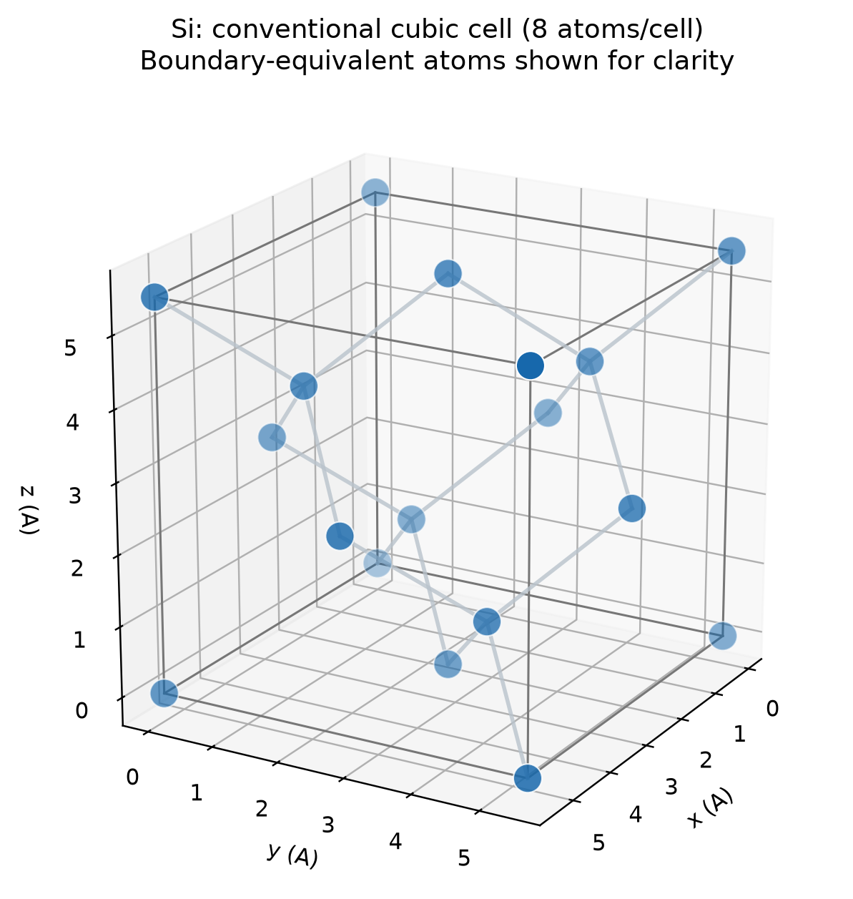

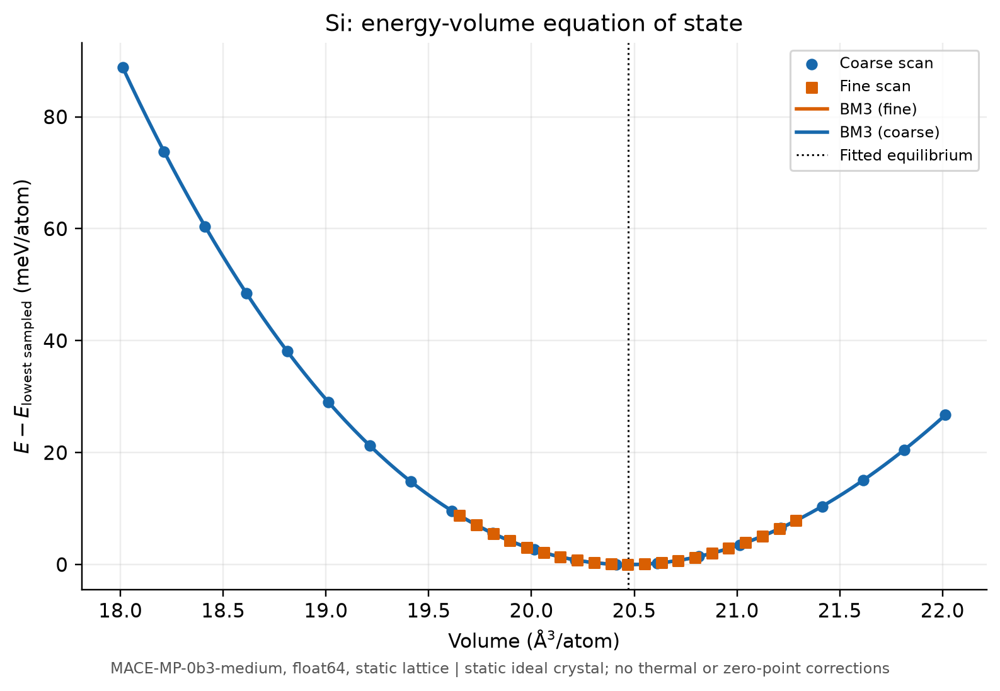

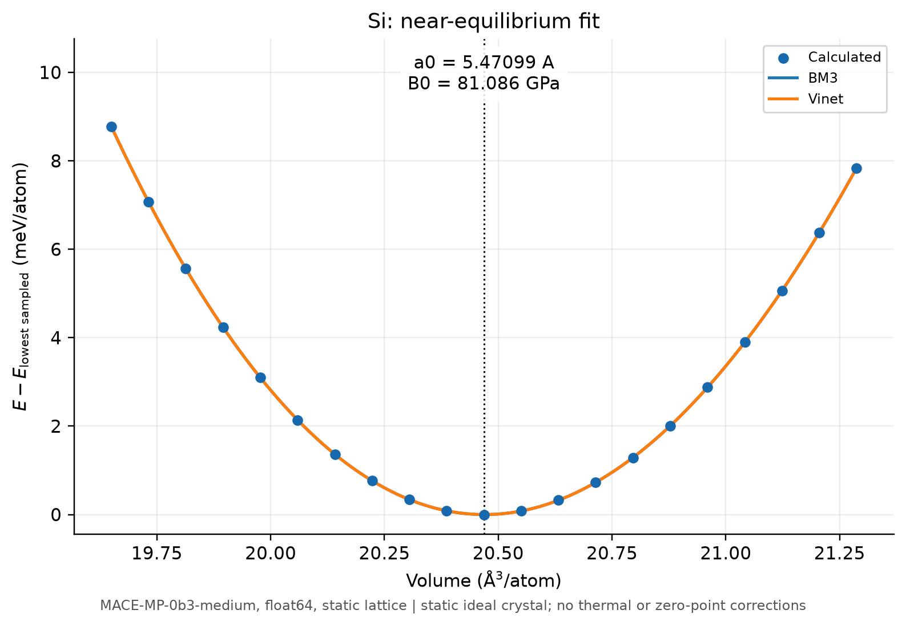

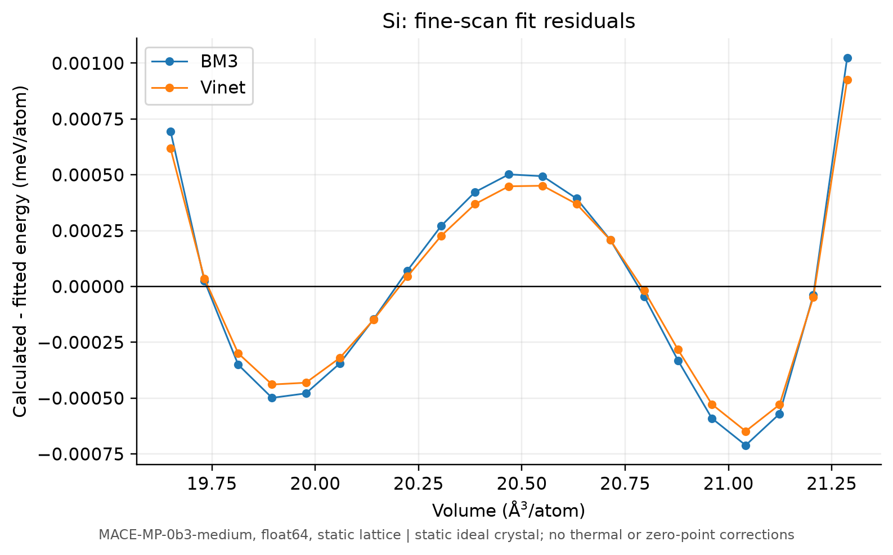

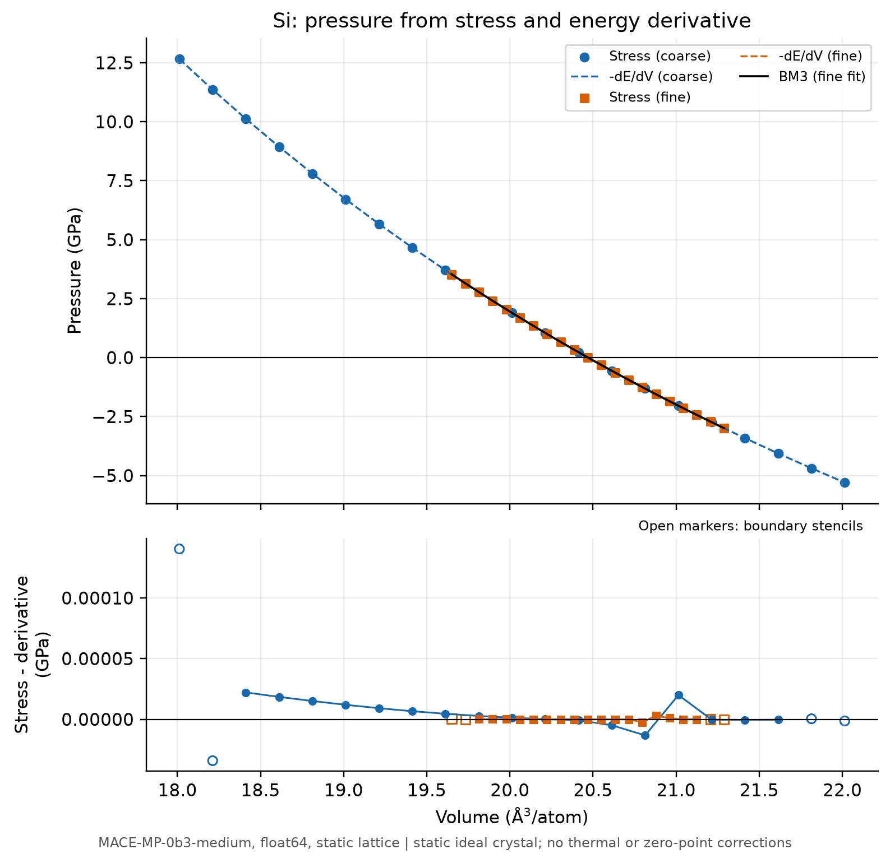

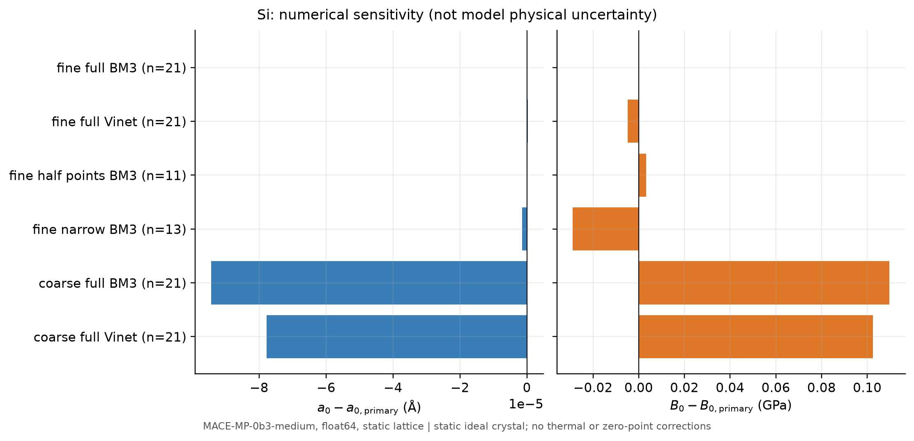

## Al：验证与数值敏感性

- EOS 平衡体积处应力压力：+0.0002808 GPa；细扫描用五点局部四次多项式求能量的一阶体积导数，其压力与应力压力的内部点 RMS 差为 3.392955e-07 GPa。边界使用不对称差分，单独标记并排除于该 RMS。
- 平衡附近独立中心差分，体积步长 0.2% / 0.1%，压力差分别为 +0.0001776564 / +4.441315e-05 GPa。
- 独立零外压晶胞优化：用应力梯度 BFGS 优化 ln(a)，从初始猜测的 98% 边长出发，保持立方及理想分数坐标。得到 a=4.06323093 Å，相对 EOS 差 +6.520178e-06 Å，压力 +9.63802e-08 GPa，优化器成功=True。
- 原胞、常规胞、2×2×2 常规超胞：每原子能量极差 0 eV/atom；完整应力分量最大差 1.546296e-14 GPa。
- 全部细扫描点 float32 对照：a₀ 差 +1.820131e-06 Å，B₀ 差 +0.0007791849 GPa，单点能量最大差 8.392937e-07 eV/atom，压力最大差 7.394121e-05 GPa。
- 扫描最大原子力 3.660733e-16 eV/Å。
- 所有 EOS/区间/点数对照产生 a₀ 总跨度 0.0004341783 Å、B₀ 总跨度 0.793852 GPa；详见 `fits.csv`。这只是数值/拟合形式敏感性，不是力场预测物理不确定度。

| 检查 | 结果 |
|---|---|
| forces | 通过 |
| pressure | 通过 |
| optimize | 通过 |
| periodicity | 通过 |
| precision | 通过 |

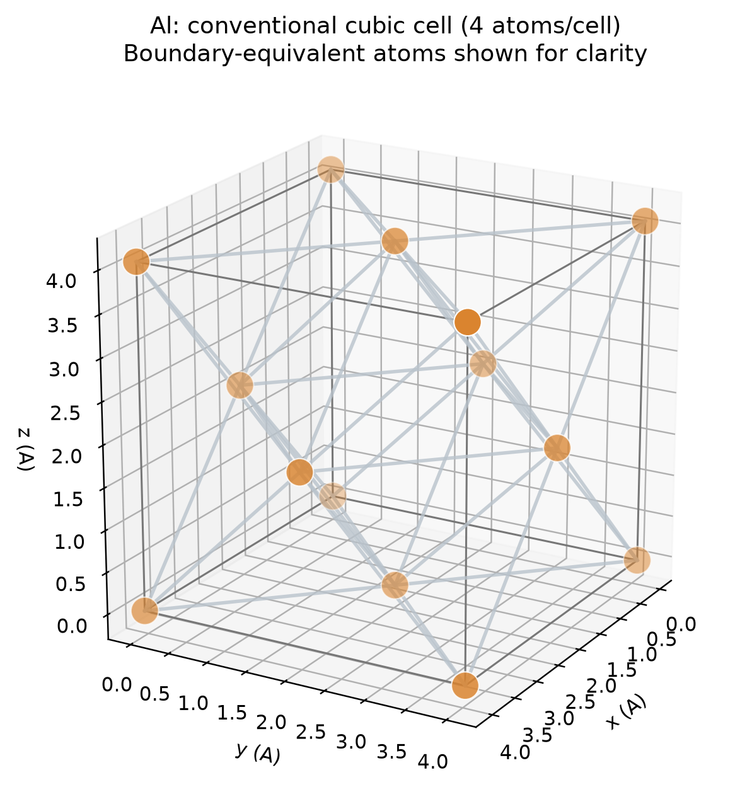

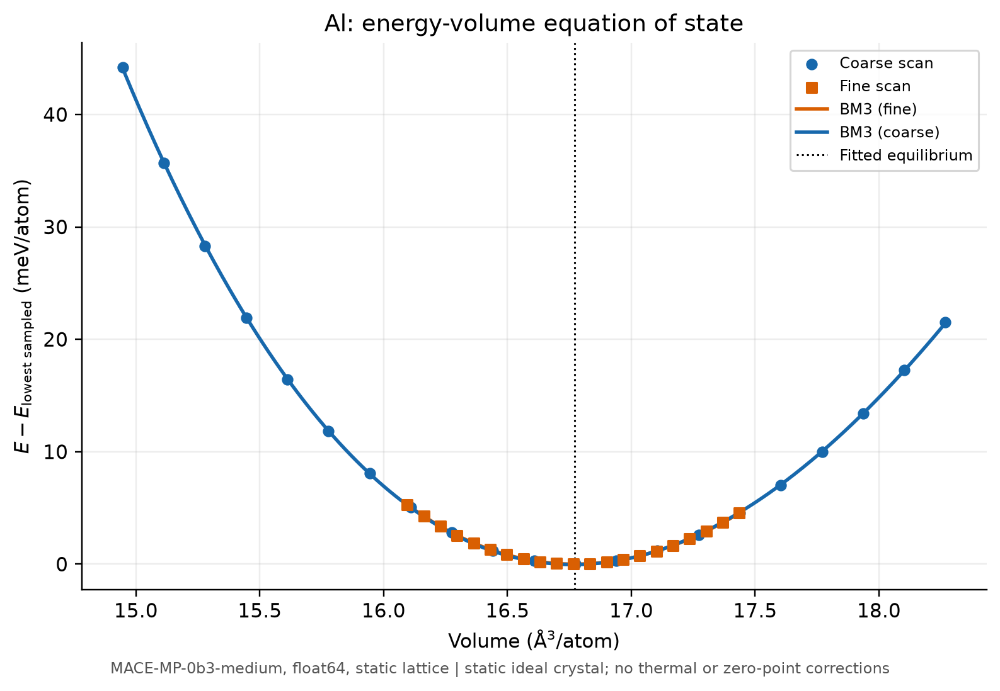

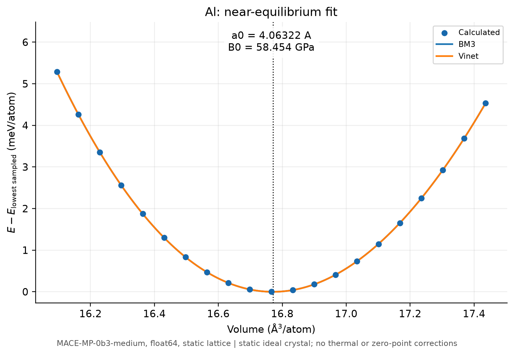

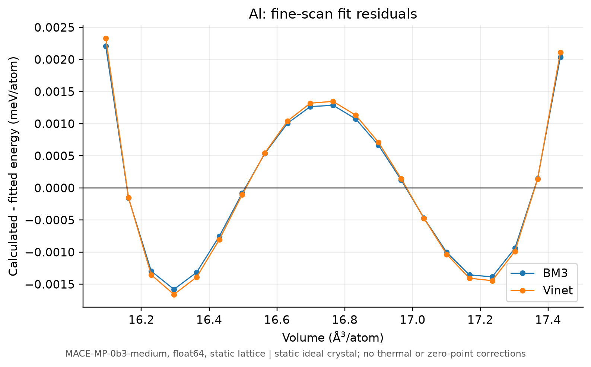

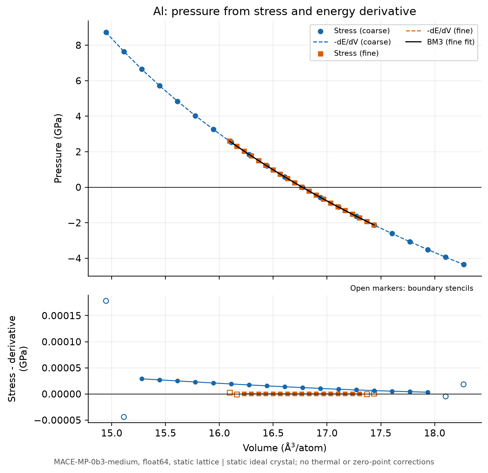

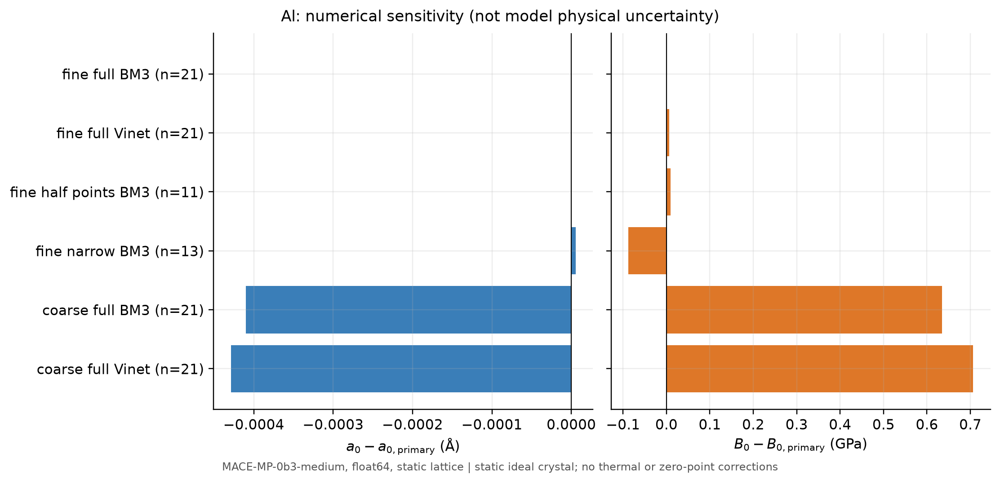

## 与原始参考数据比较

主参考是 DeltaCodesDFT 的 PBE/WIEN2k 13.1 全电子静态 EOS 数据，固定上游 commit，原文件与 SHA-256 在 `references/sources/`。晶格常数由每原子体积及常规胞原子数换算。

| 材料 | PBE 参考 a₀ (Å) | MACE 相对差 (%) | PBE 参考 B₀ (GPa) | MACE 相对差 (%) |
|---|---:|---:|---:|---:|
| Si | 5.4695173 | +0.0270 | 88.545 | -8.4242 |
| Al | 4.0395739 | +0.5855 | 78.077 | -25.1334 |

本次 Si 的晶格常数接近该 PBE 参考（+0.0270%），但体模量低 8.42%；Al 晶格常数高 0.5855%，体模量低 25.13%，存在明显的材料依赖偏差。对应 B′ 为 Si 3.06482 对参考 4.31、Al 3.62077 对参考 4.57。体模量参考差分别约 7.46 / 19.62 GPa，显著大于本次扫描范围/EOS/点数引起的 0.139 / 0.794 GPa 总跨度；float32/float64 差异也远小于这一偏差。因此，现有数值敏感性不能解释参考差，不能用拟合残差小或晶格常数接近来宣称模量准确。当前没有独立 DFT 计算，尚不能完全区分模型误差与 DFT 设置差异。

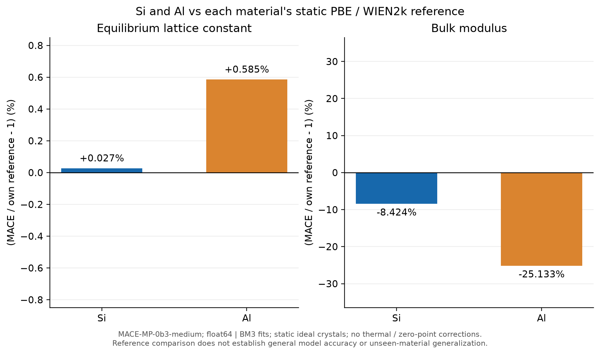

原始来源：[DeltaCodesDFT WIEN2k 数据](https://github.com/molmod/DeltaCodesDFT/blob/f9b6693763dea92d43ee48f172c02bc506876f06/WIEN2k.txt)，[Lejaeghere 等，Science，DOI 10.1126/science.aad3000](https://doi.org/10.1126/science.aad3000)。实验补充数据与 DFT 分开保存：NIST Si 295.65 K 的晶格常数，及 Al 低温超声外推 0 K 的体模量；后一数值仍不是去零点振动的静态晶格量。未核实的实验字段明确缺失。完整方法、温度、DOI、原始链接和证据见 [参考数据说明](references.md)。室温热膨胀及模量温度效应不在本项目内，因此不直接把静态预测称为室温性质，也不通过挑选某个实验值证明普遍准确。

## GPU 性能与计时范围

所有推理显式 `device="cuda"`，正式 dtype=float64。调用前后 `torch.cuda.synchronize()`，每次清空 ASE 计算缓存；计时覆盖邻居图、模型能量/力/应力和主机接口开销，属于同步端到端推理墙钟时间。模型下载、初始化、3 次预热与正式推理分开记录。CPU 基准未运行，不声称 GPU 相对 CPU 加速倍数。桌面 GPU 同时承担显示负载，小晶胞易受调用开销和系统调度影响。

| 材料 | 原子数 | 初始化 (s) | 3 次预热总和 (s) | 正式重复次数 | 正式中位数 (s) | float64 细扫描中位数 (s) | float32 细扫描中位数 (s) |
|---|---:|---:|---:|---:|---:|---:|---:|
| Si | 8 | 0.1139 | 1.2959 | 5 | 0.0459 | 0.0456 | 0.0307 |
| Al | 4 | 0.1587 | 1.8792 | 5 | 0.0583 | 0.0600 | 0.0501 |

官方权重首次实际下载耗时 83.200 s，后续从通过哈希校验的本地缓存读取。每次初始化、预热样本和所有重复值均保留于 JSON。显存峰值是本进程 PyTorch 分配器统计，可能包含精度对照两个模型，不能直接视作单一推理所需显存。

## 局限与下一步

本工作只覆盖 Si diamond 和 Al fcc 的各向同性体积变化及局部零压条件；没有声子谱、动力学稳定性、相变、缺陷、有限温度、应变弹性张量或机械各向异性验证。保持理想相是约束，宽扫描不代表该相在所有压力下热力学稳定。EOS 残差、周期一致性和精度一致性说明数值流程可靠程度，不能替代训练误差或独立高精度 DFT 的验证。

下一步可用同一 V 点开展可收敛的 PBE DFT 对照、检查训练集重叠、比较更多材料和独立模型，再加入声子/准谐近似以研究零点与有限温度修正。上述工作均未在本项目中运行。

## 数据与重现入口

`results/production/{Si,Al}/` 保存配置、运行日志、依赖版本、模型身份、原始 CSV/JSON、全部计算结构、拟合、验证、图表。`references/` 仅保存文献数据。安装与 CLI 详见 [中文 README](../README.md)。

```powershell
.\.venv\Scripts\python.exe -m mace_crystal_equilibrium check
.\.venv\Scripts\python.exe -m mace_crystal_equilibrium run --material all --mode production --output results\my_run
.\.venv\Scripts\python.exe -m mace_crystal_equilibrium refit results\production\Si
.\.venv\Scripts\python.exe scripts\build_report.py
```

只重拟合和绘图不重新调用 GPU 模型；不完整细扫描会拒绝正式拟合。测试执行证据另见 `results/test_summary.txt`。未执行的平台与 GitHub CI 不写作已通过；仓库上传状态以交付说明为准。
